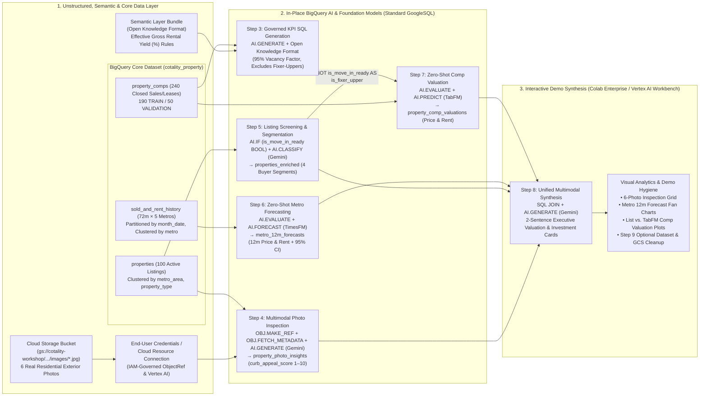

# Architecture Reference: Cotality Residential Property Valuation & Comps Demo in BigQuery

> **Document Scope**: Slide-ready Google Cloud reference architecture, component walkthrough, and live presenter guide accompanying [Cotality_property_trend_demo.ipynb](file:///usr/local/google/home/cannis/accounts/cotality/Cotality_property_trend_demo.ipynb) (`Copyright 2026 Google LLC`, `SPDX-License-Identifier: Apache-2.0`).

---

## 1. High-Definition Architecture Diagram (`16:9` Slide Asset)

---

## 2. End-to-End Component & Data-Flow Walkthrough

| Architecture Zone | Notebook Step | Google Cloud Component / SQL Operator | Foundation Model | Role in Live Demo (`Cotality_property_trend_demo.ipynb`) |
| :--- | :--- | :--- | :--- | :--- |
| **1. Data & Semantic Layer** | **Step 1 & 2.1** | **Cloud Storage** (`gs://<BUCKET>/cotality_property_demo/images/*.jpg`) | — | Stages 6 real residential exterior photographs (CC0 / Public Domain from Wikimedia Commons) covering contemporary, Mediterranean, Craftsman, wraparound-porch cottage, suburban ranch, and weathered fixer-upper homes (`PROP-101` to `PROP-106`). |
| **1. Data & Semantic Layer** | **Step 1.2** | **End-User Credentials / Cloud Resource Connection (IAM)** | — | Provides IAM-governed delegation between BigQuery `ObjectRef` pointers, Cloud Storage objects, and Vertex AI foundation models—supporting VPC Service Controls with zero signed or public URLs. |
| **1. Data & Semantic Layer** | **Step 2.2** | **BigQuery Core Dataset** (`properties`, `sold_and_rent_history`, `property_comps`) | — | Partitioned and clustered operational tables: `100` active residential listings (`properties`), `360` monthly historical price/rent rows across 5 US metros (`sold_and_rent_history`, partitioned by `month_date`, clustered by `metro_area`), and `240` closed comparable sales & leases (`property_comps`, split `190 TRAIN` / `50 VALIDATION`). |
| **1. Data & Semantic Layer** | **Step 3.1** | **Semantic Layer Bundle** (`cotality_simple_property_okf/`) | — | Portable Markdown + YAML **Open Knowledge Format** definitions encoding the governed formula and exclusions for **Effective Gross Rental Yield (%)** (`5%` annual vacancy allowance -> `0.95` collection factor; excludes fixer-uppers `is_fixer_upper = FALSE`). |
| **2. In-Place BigQuery AI/ML** | **Step 3.2** | **Governed KPI SQL Generation** (`AI.GENERATE` + Open Knowledge Format) | `Gemini` | Demonstrates ungrounded schema-only SQL generation vs. Open Knowledge Format-grounded `AI.GENERATE`, preventing KPI drift on **Effective Gross Rental Yield (%)**. |
| **2. In-Place BigQuery AI/ML** | **Step 4** | **Multimodal Photo Inspection** (`OBJ.MAKE_REF` + `OBJ.FETCH_METADATA` + `AI.GENERATE`) | `Gemini` | Inspects Cloud Storage `.jpg` house photos directly from GoogleSQL via `ObjectRef` and materializes typed columns (`architectural_style`, `exterior_condition`, `curb_appeal_score` `1–10`, `visible_features`, `photo_summary`) into `property_photo_insights`. |
| **2. In-Place BigQuery AI/ML** | **Step 5** | **Semantic Listing Screening & Segmentation** (`AI.IF` + `AI.CLASSIFY`) | `Gemini` | Screens unstructured `listing_notes` into a native SQL boolean (`is_move_in_ready BOOL`) via `AI.IF` and categorizes each home into one of 4 residential buyer segments (`Turnkey Family Home`, `Luxury Residence`, `Fixer-Upper / Value-Add`, `Starter / Cozy Home`) via `AI.CLASSIFY` into `properties_enriched`. |
| **2. In-Place BigQuery AI/ML** | **Step 6** | **Zero-Shot Metro Forecasting** (`AI.EVALUATE` + `AI.FORECAST`) | `TimesFM` | Evaluates 12-month holdout accuracy (`MAPE`, `MAE`) and forecasts the next 12 months of `median_sold_price_usd` and `avg_monthly_rent_usd` across all 5 metros (`id_cols => ['metro_area']`, `horizon => 12`, `confidence_level => 0.95`) into `metro_12m_forecasts`. |
| **2. In-Place BigQuery AI/ML** | **Step 7** | **Zero-Shot Comp Valuation** (`AI.EVALUATE` + `AI.PREDICT`, *Public Preview*) | `TabFM` | Evaluates `MAE`, `MSE`, and `R²` on `VALIDATION` comps and predicts fair-market `comp_predicted_sold_usd` and `comp_predicted_rent_usd` using `190 TRAIN` comps in context—passing `NOT is_move_in_ready AS is_fixer_upper` directly from Step 5 `AI.IF` into `property_comp_valuations` with zero `CREATE MODEL` overhead. |
| **3. Interactive Demo Synthesis** | **Step 8 & 9** | **Unified Valuation Cards & Visual Analytics** (`SQL JOIN` + `AI.GENERATE`) | `Gemini` | Joins visual curb appeal, `AI.IF` readiness, `TimesFM` 12-month metro appreciation, and `TabFM` comp valuations into 2-sentence executive **Property Valuation & Investment Cards**, accompanied by matplotlib forecast fan charts, comp comparison plots, and optional Step 9 dataset/storage cleanup. |

---

## 3. Presenter Talk Track (60-Second Architecture Slide Walkthrough)

1. **Left Zone — Simple 3-Table Foundation + Unstructured Photos**:
   - *"We start with the three tables every property analytics team knows by heart—active **Properties**, monthly **Sold & Rent History**, and closed **Property Comps**—plus **real residential exterior photos** in Cloud Storage and a portable **Open Knowledge Format** semantic bundle that defines our governed **Effective Gross Rental Yield (%)** metric."*
2. **Center Zone — Five In-Place Foundation Model Capabilities in Standard GoogleSQL**:
   - *"Without moving data out of BigQuery or maintaining separate Python/ML serving pipelines, we execute five AI operations in place: **Open Knowledge Format grounding** with `AI.GENERATE` (Step 3), **multimodal photo inspection** via `OBJ.MAKE_REF` and `AI.GENERATE` (Step 4), **semantic listing screening** with `AI.IF` and `AI.CLASSIFY` (Step 5), **zero-shot 12-month metro forecasting** with `AI.FORECAST` powered by **TimesFM** (Step 6), and **zero-shot tabular comp valuation** with `AI.PREDICT` powered by **TabFM** (Step 7). Notice how the boolean output of `AI.IF` (`NOT is_move_in_ready`) feeds straight into `AI.PREDICT` as `is_fixer_upper`!"*
3. **Right Zone — Unified Executive Decision Cards**:
   - *"Finally, in Step 8, one standard SQL `JOIN` combines visual curb appeal, listing readiness, 12-month metro appreciation, and comp-backed price and rent estimates into an executive 2-sentence **Property Valuation & Investment Card**."*

---

## 4. Editable Mermaid Source (For Slide / Doc Customization)

