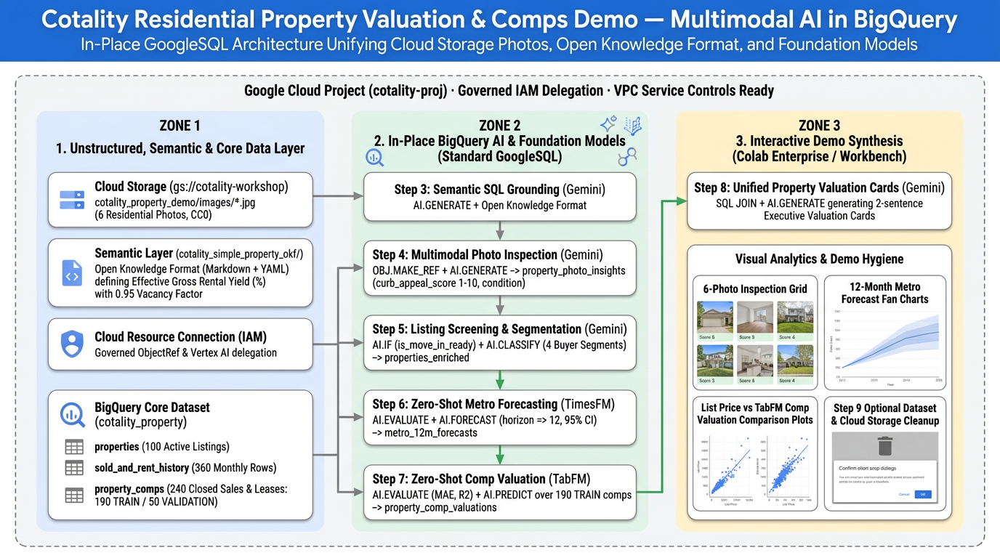

# Project 1: Real Estate Property AI & Trend Valuation Engine

An enterprise-grade cloud AI and analytics proof-of-concept demonstrating **Multimodal Generative AI, Foundation Time-Series Forecasting (`TimesFM`), Zero-Shot Tabular Valuation (`TabFM`), Open Knowledge Format (OKF) semantic grounding, and Cloud Run interactive web applications** directly integrated with **Google Cloud BigQuery**.



---

## 🎯 Project Overview & Objectives

In modern real estate analytics and mortgage underwriting, traditional valuation models struggle to synthesize unstructured property imagery, historical regional price fluctuations, and portfolio underwriting guidelines into unified decision-making. 

This project demonstrates how data engineers and ML practitioners can build an end-to-end, in-database AI engine that:
1. **Performs Multimodal Visual Inspection**: Extracts condition, architectural style, and curb appeal from property exterior photos stored in GCS via BigQuery Object Tables and Gemini multimodal SQL.
2. **Forecasts Multi-Year Trends (`TimesFM`)**: Leverages Google's zero-training foundation time-series model to forecast 12-month median prices and rents across metro areas with confidence intervals.
3. **Conducts In-Context Tabular Valuation (`TabFM`)**: Predicts fair-market valuation and rental yield from historical comp records without traditional model training pipelines.
4. **Applies Semantic Grounding (OKF)**: Grounds LLM-generated analytics in certified metric definitions and underwriting policies.
5. **Serves Interactive Business Insights**: Delivers an 8-stage interactive Streamlit web application on Cloud Run for executive and analyst exploration.

---

## 📂 Repository Contents

| Component | Description |
| :--- | :--- |
| **`cloudrun_webapp/`** | Interactive **Streamlit** WebApp runnable locally or deployable to **Cloud Run**, featuring 8 demo stages, live SQL execution, and presenter talk tracks. |
| **`Cotality_property_trend_demo.ipynb`** | Full end-to-end Jupyter notebook walkthrough covering dataset setup, multimodal analysis, forecasting, valuation, and executive briefs. |
| **`cotality_simple_property_aiml_lab.ipynb`** | Accelerated BigQuery AI/ML hands-on lab notebook. |
| **`cotality_property_aiml_lab.ipynb`** | Deep-dive hands-on lab notebook for advanced property AI/ML patterns. |
| **`Cotality_property_trend_demo_architecture.md`** / **`.png`** / **`.svg`** | 16:9 Google Cloud reference architecture diagram and specification. |
| **`Cotality_property_trend_demo_talk_track.md`** | Stage-by-stage presenter talk track with customer value takeaways. |
| **`cotality_query_optimization_case_studies.md`** / **`cotality_qopt_cs*.png`** | BigQuery query optimization, clustering/partitioning, and performance case studies. |
| **`cotality_bq_best_practices_slide.md`** / **`.png`** | Slide narrative and visual summary of BigQuery AI/ML best practices. |
| **`cotality_property_okf/`** | Semantic Open Knowledge Format bundle (datasets, tables, metrics, computations, policies) for enterprise AI grounding. |
| **`cotality_simple_property_okf/`** | Lightweight OKF bundle for quick-start grounding. |
| **`property_images/`** | CC0 residential exterior imagery (`PROP-101` to `PROP-106`) with licensing documentation. |

---

## 🛠️ Tech Stack & Google Cloud Services

- **Database & Warehouse**: Google Cloud BigQuery (Standard SQL, Object Tables, Storage API)
- **AI & Foundation Models**: Gemini Multimodal, TimesFM (Time-Series Foundation Model), TabFM (Tabular Foundation Model)
- **Compute & Deployment**: Google Cloud Run, Docker, Gunicorn / Streamlit
- **Visualization**: Streamlit, Plotly Express & Graph Objects, PyDeck
- **Semantic Grounding**: Open Knowledge Format (OKF) specification

---

## 🚀 Quick Start: Streamlit Web Application

### Local Development Setup

```bash
cd cloudrun_webapp
python3 -m venv .venv
source .venv/bin/activate
pip install -r requirements.txt

# Configure your Google Cloud environment variables
export PROJECT_ID="<YOUR_PROJECT_ID>"
export DATASET_ID="cotality_property"
export LOCATION="US"
export BUCKET_NAME="<YOUR_GCS_BUCKET>"
export CONNECTION_ID="us.cotality-conn"

streamlit run app.py --server.port 8080
```

### Deploying to Google Cloud Run

```bash
cd cloudrun_webapp
chmod +x deploy.sh
./deploy.sh
```

---

## 📓 Running the Notebooks

1. Upload `Cotality_property_trend_demo.ipynb` or `cotality_simple_property_aiml_lab.ipynb` to **Vertex AI Workbench** or run in **JupyterLab** / **Colab Enterprise**.
2. Set your Google Cloud Project ID and authenticate with BigQuery credentials.
3. Step through the stages to generate tables, run Gemini multimodal queries, evaluate `TimesFM`, and perform `TabFM` valuations.
