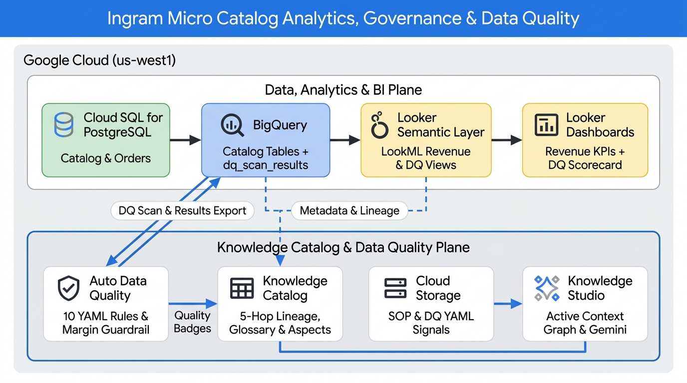

# Project 2: Enterprise Data, Database, Analytics, Governance & BI Pipeline

An enterprise-grade data engineering and analytics proof-of-concept demonstrating **Operational Database Replication, Federated ELT, Automated Data Quality Scans, 5-Hop Lineage Tracking, Semantic Business Intelligence, and Grounded AI Context** on **Google Cloud**.



---

## 🎯 Project Overview & Objectives

In large B2B distribution and e-commerce enterprises, data inconsistency between transactional operational databases and reporting data warehouses often leads to revenue leakage, margin compression, and untrusted business reports.

This project delivers a complete enterprise data pipeline and data quality operating model that:
1. **Seeds & Manages Operational Data**: Powers a production-like Cloud SQL for PostgreSQL database with master product catalog and reseller transaction records.
2. **Executes Federated Zero-ETL / ELT**: Ingests and transforms data into Google Cloud BigQuery using External Connections (`EXTERNAL_QUERY`) with zero intermediate staging infrastructure.
3. **Enforces Automated Data Quality**: Defines 10 declarative Dataplex Auto DQ rules across 5 dimensions (`COMPLETENESS`, `UNIQUENESS`, `VALIDITY`, `CONSISTENCY`, `INTEGRITY`), pushing compute into BigQuery.
4. **Tracks End-to-End 5-Hop Lineage**: Automatically bridges metadata and lineage from Cloud SQL tables through BigQuery transformation, data quality scan exports, LookML views, and executive dashboards.
5. **Provides Looker Semantic Modeling & Trust KPIs**: Implements LookML views, explains business metrics (Net Recognized Revenue, Distributor Gross Margin), and powers both Executive Overview and Steward Remediation dashboards.
6. **Enables Grounded AI Triage**: Grounds conversational AI assistants (Knowledge Studio) in certified SOP business definitions and data quality scan telemetry.

---

## 📂 Repository Structure

```text
02_enterprise_data_governance_pipeline/
├── assets/
│   └── ingram_micro_architecture.png        # Full pipeline architecture diagram
├── demo_walkthrough.md                      # Click-by-click 15-minute live demo playbook
├── docs/
│   └── ingram_micro_catalog_revenue_sop.md  # Certified revenue formulas & Golden SQL SOP
├── dq/
│   ├── products_dq_spec.yaml                # Dataplex Auto DQ rules for products table
│   └── transactions_dq_spec.yaml            # Dataplex Auto DQ rules for transactions table
├── lookml/
│   ├── ingram_micro_revenue.model.lkml      # Looker semantic model
│   ├── views/
│   │   ├── products.view.lkml               # Product catalog dimensions & measures
│   │   ├── product_transactions.view.lkml   # Reseller orders, revenue, discount & margin
│   │   └── dq_scan_results.view.lkml        # Parsed Auto DQ metrics & remediation SQL
│   └── dashboards/
│       ├── ingram_revenue_overview.dashboard.lookml         # Dashboard #4 (Executive Revenue)
│       └── ingram_data_quality_scorecard.dashboard.lookml   # Dashboard #5 (Data Quality Scorecard)
├── scripts/
│   ├── publish_lineage_and_context.py       # Cloud SQL -> BigQuery lineage & glossary links
│   └── publish_dq_lineage_and_aspect.py     # DQ lineage and governance aspect publisher
└── sql/
    ├── 01_cloudsql_catalog_seed.sql         # DDL & seed data for Cloud SQL PostgreSQL
    ├── 02_bigquery_elt.sql                  # Federated EXTERNAL_QUERY ELT to BigQuery
    └── 03_seed_dq_anomaly.sql               # Anomaly injection to demonstrate DQ alerts
```

---

## 🛠️ Tech Stack & Google Cloud Services

- **Operational Database**: Cloud SQL for PostgreSQL
- **Analytics & Data Warehouse**: Google Cloud BigQuery (Standard SQL, BigQuery Connection API)
- **Data Governance & Quality**: Google Cloud Dataplex (Auto Data Quality DataScans, Knowledge Catalog)
- **Metadata & Lineage**: Dataplex Data Lineage API
- **Business Intelligence**: Looker Core / LookML
- **AI Context & Grounding**: Knowledge Studio

---

## 🚀 Setup & Execution Guide

### Step 1: Provision Operational Cloud SQL Database
Execute `sql/01_cloudsql_catalog_seed.sql` on your Cloud SQL for PostgreSQL instance:
- Creates `products` table (11 initial SKUs).
- Creates `product_transactions` table (20 reseller orders).

### Step 2: Run BigQuery Federated ELT
1. Create a BigQuery Cloud SQL external connection:
   ```bash
   gcloud bigquery connections create cloudsql \
       --connection_id="ingram-cloudsql-conn" \
       --location="us-west1" \
       --database="ingram_catalog" \
       --type="POSTGRES" \
       --instance="<PROJECT_ID>:us-west1:ingram-catalog-sql"
   ```
2. Execute `sql/02_bigquery_elt.sql` in BigQuery Studio to replicate tables into dataset `ingram_micro_analytics` and materialize `sku_revenue_summary`.

### Step 3: Deploy Declarative Auto Data Quality Scans
Deploy Dataplex DataScans with BigQuery result export enabled:
```bash
gcloud dataplex datascans create data-quality ingram-products-dq-scan \
    --location="us-west1" \
    --data-source-table="projects/<PROJECT_ID>/datasets/ingram_micro_analytics/tables/products" \
    --data-quality-spec-file="dq/products_dq_spec.yaml"

gcloud dataplex datascans create data-quality ingram-transactions-dq-scan \
    --location="us-west1" \
    --data-source-table="projects/<PROJECT_ID>/datasets/ingram_micro_analytics/tables/product_transactions" \
    --data-quality-spec-file="dq/transactions_dq_spec.yaml"
```

### Step 4: Inject Test Data Quality Anomaly
Run `sql/03_seed_dq_anomaly.sql` in Cloud SQL to insert SKU `IM-OEM-ERR99` (priced below cost: \$3,850 price vs \$4,200 cost).
Re-run the BigQuery ELT and Dataplex DataScan to observe:
- Product table quality score drops to **80.0%**.
- Active violation flagged on `margin-floor-guardrail`.
- Auto-generated remediation SQL query populated in `dq_scan_results`.

### Step 5: Publish Lineage and Governance Metadata
Run the helper scripts using ambient credentials:
```bash
python3 scripts/publish_lineage_and_context.py
python3 scripts/publish_dq_lineage_and_aspect.py
```

### Step 6: Deploy LookML Model & Dashboards
Copy the files in `lookml/` into your Looker project (`ingram_micro_catalog`):
- Point connection to BigQuery dataset `ingram_micro_analytics`.
- Open **Dashboard #4** for certified Executive Revenue & Trust metrics.
- Open **Dashboard #5** for steward drill-down and copy-paste remediation queries.

---

## 📖 Live Demonstration Playbook

For step-by-step click choreography and presenter talk tracks, see [demo_walkthrough.md](./demo_walkthrough.md).
