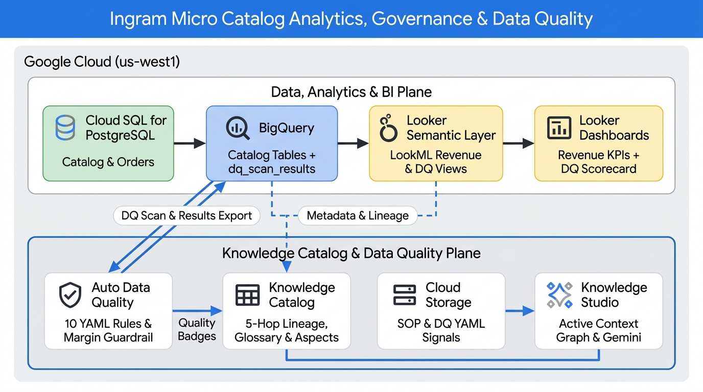
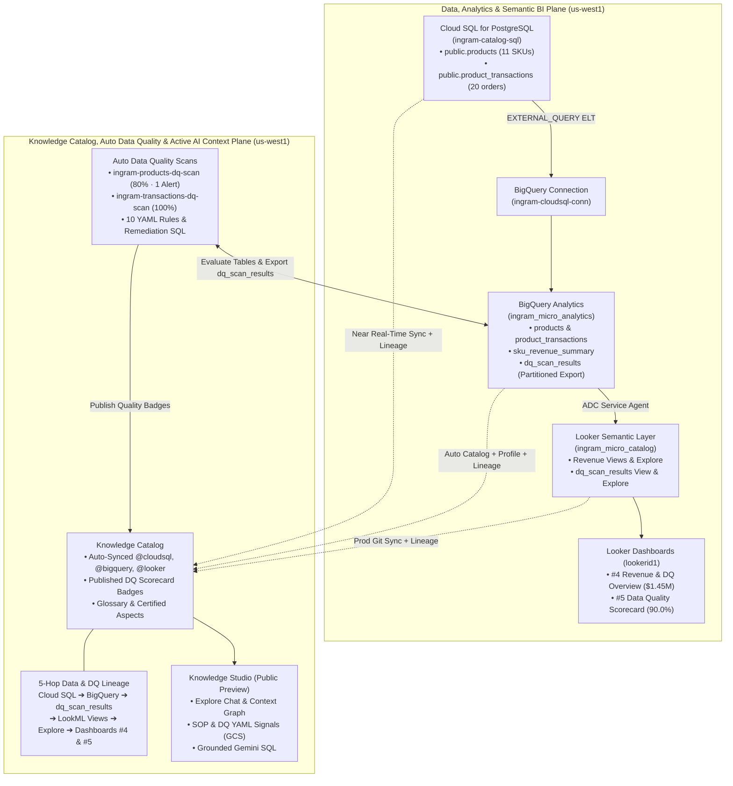

# Ingram Micro End-to-End Architecture, Data Quality Operating Model & Live Demo Playbook

## 1. Architectural Topology & Data / Governance Flows

All operational, analytical, data quality, BI, and AI context resources are co-located in **`us-west1`** inside project **`demo1-371900`** so Cloud SQL near-real-time catalog sync, BigQuery federation, Auto Data Quality scans, Looker (Google Cloud core), 5-hop Data Lineage, and Knowledge Studio Context Sets share a unified regional boundary.

---

## 2. Enterprise Operating Model: Managing Data Quality Across BigQuery, Knowledge Catalog & Looker

1. **Declarative YAML + Profile-Driven Authoring (Knowledge Catalog & GitOps)**:
   - Run **Data Profile** scans on BigQuery tables to auto-recommend baseline rules (`nonNullExpectation`, `uniquenessExpectation`, `regexExpectation`, `rangeExpectation`, `setExpectation`), and layer domain-specific **Custom SQL Rules** (`rowConditionExpectation` for `unit_price_usd >= unit_cost_usd` margin floors and cross-table `IN (SELECT sku ...)` referential integrity).
   - Store specs in version control (`dq/products_dq_spec.yaml`, `dq/transactions_dq_spec.yaml`) and deploy via `gcloud dataplex datascans` or Terraform.
2. **Serverless Pushdown Execution & Partitioned BigQuery Export (`dq_scan_results`)**:
   - Auto Data Quality pushes validation compute directly into BigQuery (with incremental watermark support for high-volume order tables).
   - Configure `postScanActions.bigqueryExport.resultsTable` (`demo1-371900.ingram_micro_analytics.dq_scan_results`) so every job writes rule pass percentages, table scores (`job_quality_result.score`), and **auto-generated steward remediation queries (`rule_failed_records_query`)**, while Cloud Logging alerts on failures.
3. **Catalog Trust Badges & Knowledge Studio Grounding**:
   - Setting `catalogPublishingEnabled: true` publishes the `data-quality-scorecard` aspect onto `@bigquery` catalog entries (`products`: `80%` with `CONSISTENCY` alert; `product_transactions`: `100%`), visible in **Knowledge Catalog Search**, **5-hop Lineage**, and **Knowledge Studio** conversational queries.
4. **Looker Semantic Layer & Data Quality Scorecard (`Dashboards #4 & #5`)**:
   - LookML `explore: dq_scan_results` filters automatically to the latest scan job per table (`sql_always_where`), powering executive trust KPIs alongside revenue on **Dashboard #4** and steward drilldowns + remediation SQL on **Dashboard #5**, with native Looker Scheduled Alerts when `rules_failed_count > 0`.

---

## 3. Pre-Demo 6-Tab Browser Setup

| Tab | Role in Story | URL |
| :--- | :--- | :--- |
| **Tab 1** | Executive Revenue + DQ Overview (Looker Dashboard #4) | https://b32614df-01c4-4ed9-a021-b25e94d9bebb.looker.app/dashboards/4 |
| **Tab 2** | Dedicated Data Quality Scorecard (Looker Dashboard #5) | https://b32614df-01c4-4ed9-a021-b25e94d9bebb.looker.app/dashboards/5 |
| **Tab 3** | Semantic Rulebook (LookML `dq_scan_results.view.lkml`) | https://b32614df-01c4-4ed9-a021-b25e94d9bebb.looker.app/projects/ingram_micro_catalog/files/views/dq_scan_results.view.lkml |
| **Tab 4** | Source, Warehouse & Remediation SQL (BigQuery Studio) | https://console.cloud.google.com/bigquery?project=demo1-371900 |
| **Tab 5** | Unified Catalog, DQ Badges & 5-Hop Lineage | https://console.cloud.google.com/dataplex/dp-search?project=demo1-371900 |
| **Tab 6** | Active AI Context (Knowledge Studio) | https://console.cloud.google.com/dataplex/studio?project=demo1-371900 |

---

## 4. Click-by-Click 15-Minute Live Demo Choreography

1. **Act 1 — Executive KPIs + Embedded DQ Trust (Tab 1):** Show **\$1,452,445.56** Net Recognized Revenue, **\$181,265.56** Distributor Gross Margin, and scroll down to the embedded **DQ Scorecard** (`90.0%` Rule Pass Rate, `9` Passed, `1` Active Violation on `CONSISTENCY`).
2. **Act 2 — Cloud SQL to BigQuery Federation (Tab 4):** Show `ingram_micro_analytics` (`products`, `product_transactions`, `sku_revenue_summary`, `dq_scan_results`) fed via `EXTERNAL_QUERY` from `ingram-catalog-sql`.
3. **Act 3 — Published DQ Badges & 5-Hop Lineage in Knowledge Catalog (Tab 5):** Open `ingram_micro_analytics.products` ➔ **Data Quality** tab (`80%` score, `margin-floor-guardrail` flagged) and **Lineage** tab (showing both the Revenue lineage to Dashboard `#4` and the DQ lineage through `dq_scan_results` to Dashboard `#5`).
4. **Act 4 — Steward Remediation from Looker DQ Scorecard (Tabs 2 & 4):** Open **Dashboard #5**, inspect *Table-Level Quality Score* (`products: 80.0`, `product_transactions: 100.0`), copy `rule_failed_records_query` from the `margin-floor-guardrail` row, and run it in BigQuery Studio to pinpoint draft SKU **`IM-OEM-ERR99`** (`unit_cost_usd = \$4,200`, `unit_price_usd = \$3,850`, `active = false`).
5. **Act 5 — Grounded AI Revenue & DQ Triage in Knowledge Studio (Tab 6):** Run the revenue-by-category prompt (reconciling to **\$1,452,445.56**) followed by *"Check our Ingram Micro data quality scan results in BigQuery. Which table and rule currently have a violation, and which SKU caused it?"*
